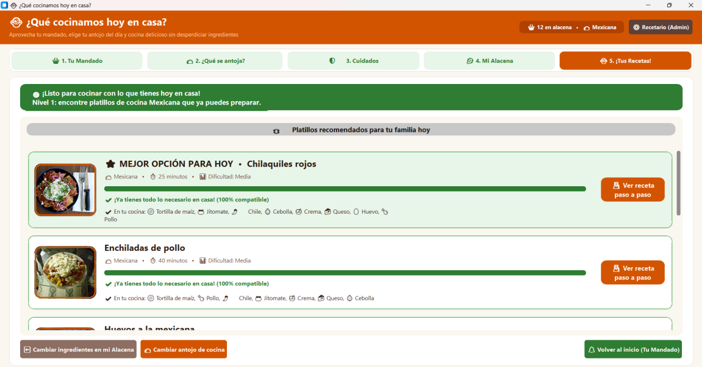
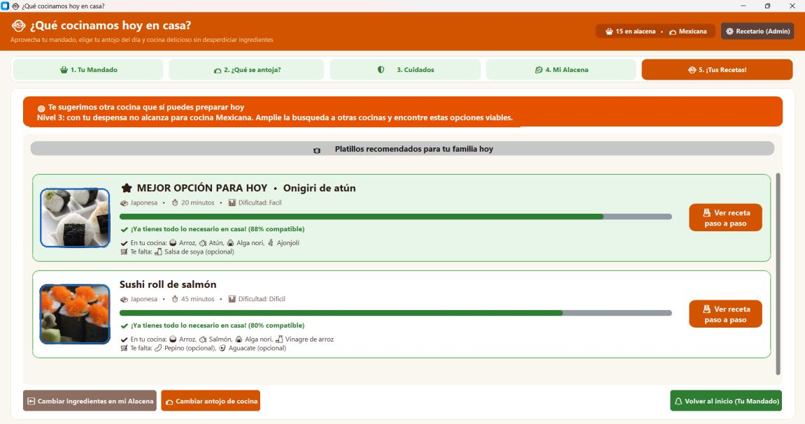
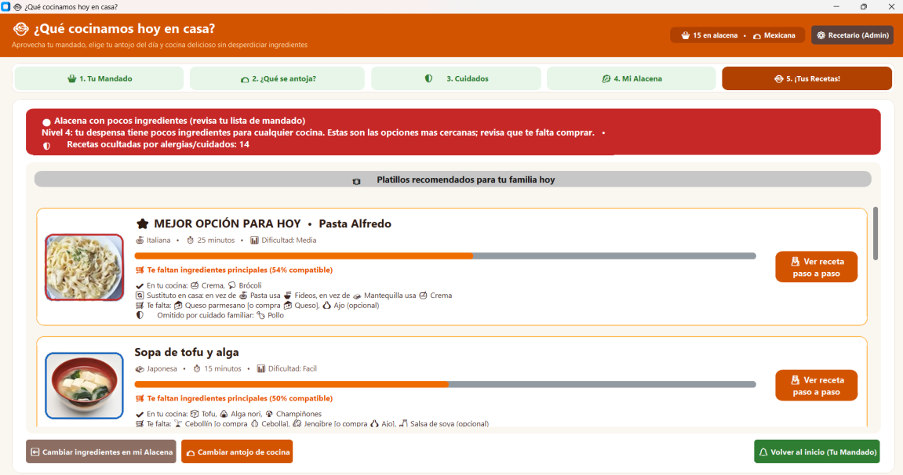

# Sistema Inteligente de Recomendación de Platillos — Producto Integrador de Aprendizaje (PIA)

## 1. Descripción General del Proyecto

El **Sistema Inteligente de Recomendación de Platillos** es una aplicación de escritorio desarrollada para la unidad de aprendizaje de **Sistemas Adaptativos** (FIME - UANL). El sistema resuelve la problemática cotidiana de decidir qué cocinar en el hogar aprovechando los insumos realmente disponibles en la alacena, adaptándose en tiempo real a tres variables dinámicas:

1. **Inventario de la despensa:** Ingredientes disponibles en el hogar en un momento dado.
2. **Preferencia culinaria (antojo del día):** Selección entre cinco cocinas internacionales (*Mexicana, Italiana, Japonesa, India, China*) o recomendación abierta (*Sorpréndeme*).
3. **Restricciones alimentarias y alergias:** Filtros prioritarios de salud y dieta (*Vegetariano, Sin gluten, Sin lácteos, Sin huevo, Sin mariscos, Sin soya, Sin frutos secos*).

El motor adaptativo evalúa un catálogo de 40 recetas y más de 60 ingredientes mediante un modelo de **filtrado estricto de restricciones**, **puntuación ponderada de compatibilidad (0% a 100%)**, **sustitución inteligente con insumos disponibles en casa** y **relajación progresiva de criterios en 4 niveles**, cerrando el ciclo de retroalimentación cuando el usuario prepara un platillo y el inventario se actualiza automáticamente.

---

## 2. Tecnologías y Dependencias Utilizadas

* **Lenguaje de programación:** Python 3.10 o superior.
* **Interfaz gráfica de usuario (GUI):** `customtkinter` (>= 5.2.0) sobre `tkinter` para componentes visuales modernos y adaptables.
* **Procesamiento de imágenes:** `Pillow` (>= 10.0.0) para la carga, redimensionamiento y almacenamiento en caché local de fotografías de platillos y tipos de cocina.
* **Base de datos:** `SQLite3` (integrado en la biblioteca estándar de Python) para la persistencia relacional local en `data/cocina.db`.
* **Pruebas automatizadas:** `unittest` (biblioteca estándar de Python) para la validación de los escenarios de adaptación.

Contenido de `requirements.txt`:
```text
customtkinter>=5.2.0
pillow>=10.0.0
```

---

## 3. Requisitos de Instalación

* **Sistema Operativo:** Windows 10/11, macOS o Linux con entorno gráfico.
* **Intérprete:** Python 3.10 o superior instalado y agregado al `PATH` del sistema.
* **Gestor de paquetes:** `pip` actualizado.
* **Conexión a Internet (opcional):** Únicamente requerida la primera vez si se desea descargar fotografías nuevas no incluidas en la caché local `data/fotos/`. El motor adaptativo y la base de datos operan de forma 100% local sin requerir servidor externo.

---

## 4. Instrucciones para Configurar y Ejecutar el Sistema

### Opción A: Ejecución rápida en Windows
Hacer doble clic sobre el archivo [`ejecutar.bat`](file:///C:/Users/prixe/Downloads/Proyecto_SA/ejecutar.bat) ubicado en la raíz del proyecto, o ejecutarlo desde la terminal:
```bat
ejecutar.bat
```

### Opción B: Configuración y ejecución manual desde terminal
1. Clonar o descargar el repositorio y ubicarse en la carpeta raíz del proyecto:
   ```bash
   git clone https://github.com/Prixel336k/PIA-SA.git
   cd PIA-SA
   ```
2. (Opcional) Crear y activar un entorno virtual:
   ```bash
   python -m venv .venv
   .venv\Scripts\activate
   ```
3. Instalar las dependencias requeridas:
   ```bash
   python -m pip install -r requirements.txt
   ```
4. Iniciar la aplicación:
   ```bash
   python src/main.py
   ```
   *Nota:* En la primera ejecución, el sistema crea e inicializa automáticamente la base de datos SQLite en `data/cocina.db` a partir de `data/schema.sql` y `data/seed_data.py`.

### Ejecución de las pruebas automatizadas
Para ejecutar los 8 escenarios de validación del mecanismo adaptativo:
```bash
python -m unittest discover tests
python tests/test_escenarios.py
```

---

## 5. Estructura General del Proyecto

```text
Proyecto_SA/
├── data/
│   ├── schema.sql               # Esquema relacional de la base de datos SQLite
│   ├── seed_data.py             # Catálogo semilla (40 recetas, 60+ ingredientes y sustitutos)
│   ├── cocina.db                # Base de datos SQLite generada automáticamente
│   └── fotos/                   # Caché local de fotografías de platillos y tipos de cocina
├── docs/
│   └── capturas/                # Capturas de pantalla para la guía de usuario y evidencias
├── src/
│   ├── main.py                  # Punto de entrada principal de la aplicación
│   ├── db.py                    # Capa de acceso a datos y operaciones CRUD en SQLite
│   ├── logica/
│   │   ├── restricciones.py     # Filtrado prioritario por alergias y dietas
│   │   ├── puntuacion.py        # Cálculo de compatibilidad ponderada (0% - 100%)
│   │   ├── sustitutos.py        # Búsqueda de sustitutos disponibles que respeten restricciones
│   │   └── adaptacion.py        # Relajación progresiva (Niveles 1 a 4) y ciclo de retroalimentación
│   └── ui/
│       ├── app.py               # Ventana principal organizada en 5 vistas progresivas
│       ├── revision_despensa.py # Diálogo de revisión rápida de ingredientes agotados
│       ├── receta.py            # Vista de preparación paso a paso y descuento de inventario
│       ├── admin.py             # Panel CRUD de administración de recetas e ingredientes
│       ├── imagenes.py          # Gestión y renderizado de imágenes del catálogo
│       └── estilo.py            # Configuración tipográfica y paleta de colores
├── tests/
│   └── test_escenarios.py       # Batería de pruebas unitarias de los escenarios adaptativos
├── ejecutar.bat                 # Script de arranque directo en Windows
├── requirements.txt             # Dependencias externas del sistema
└── README.md                    # Documentación técnica y guía de usuario
```

---

## 6. Guía de Usuario

La interfaz del sistema está estructurada en **cinco vistas progresivas** accesibles desde la barra de navegación superior para guiar al usuario paso a paso:

### Paso 1: Verificación del mandado (`1. Tu Mandado`)
* Al abrir la aplicación en un día distinto al del último registro, el sistema pregunta si el usuario conserva la misma despensa registrada previamente.
* **Si conserva la misma despensa:** Avanza directamente a la selección de cocina.
* **Si ya se agotaron algunos insumos:** Abre la ventana de **Revisión rápida de alacena**, donde se pueden desmarcar con un clic los ingredientes que se terminaron.
* También permite cargar un inventario básico inicial con el botón **Cargar mandado básico** o limpiar la alacena.

### Paso 2: Selección de preferencia culinaria (`2. ¿Qué se antoja?`)
* Presenta tarjetas visuales con fotografía para elegir el antojo del día: **Mexicana, Italiana, Japonesa, India, China** o la opción abierta **Sorpréndeme (Todas)**.
* Al seleccionar una tarjeta, el motor filtra o prioriza dicha cocina y avanza a la siguiente etapa.

### Paso 3: Configuración de restricciones alimentarias (`3. Cuidados`)
* Permite activar o desactivar restricciones de salud o dieta familiar: **Vegetariano, Sin gluten, Sin lácteos, Sin huevo, Sin mariscos, Sin soya y Sin frutos secos**.
* Las restricciones tienen **prioridad máxima**: toda receta con un ingrediente esencial restringido se descarta inmediatamente; si el ingrediente restringido es opcional, se omite de la receta y se notifica al usuario.

### Paso 4: Gestión detallada de la alacena (`4. Mi Alacena`)
* Muestra el catálogo completo de ingredientes organizado por categorías (*Verduras y frutas, Carnes y proteínas, Lácteos y huevo, Granos y pastas, Salsas y especias*) junto con un buscador en tiempo real.
* Cada clic marca o desmarca la disponibilidad del ingrediente en la base de datos y actualiza el contador superior.

### Paso 5: Platillos recomendados y preparación (`5. ¡Tus Recetas!`)
* Muestra una cinta superior de estado indicando el **Nivel de adaptación (Nivel 1 a Nivel 4)** aplicado por el motor:
  
  * **Nivel 1 (Verde):** Recetas de la cocina elegida con compatibilidad $\ge 60\%$ y todos los ingredientes esenciales disponibles (o cubiertos por un sustituto en casa).
  * **Nivel 2 (Ámbar):** Cuando ninguna receta alcanza el Nivel 1, reduce el umbral al $40\%$ dentro de la cocina seleccionada e indica qué ingrediente esencial falta.
  * **Nivel 3 (Terracota):** Si la alacena es insuficiente para la cocina solicitada, amplía automáticamente la búsqueda a otras cocinas del catálogo con platillos viables:
    
  * **Nivel 4 (Alerta):** Cuando la despensa tiene muy pocos ingredientes para cualquier cocina, muestra los platillos más cercanos y los insumos necesarios para completar la compra:
    
* Al presionar **Ver receta paso a paso**, se despliega la ventana con instrucciones numeradas, tiempo, dificultad, ingredientes utilizados y sustitutos aplicados.
* Al pulsar **Ya lo cociné (descontar ingredientes)**, el sistema elimina de la despensa los insumos utilizados y recalcula automáticamente las recomendaciones restantes, cerrando el ciclo adaptativo.

### Panel Administrador (`Recetario (Admin)`)
* Accesible desde la esquina superior derecha.
* **Pestaña Recetas:** Permite agregar nuevas recetas, editar existentes o eliminarlas, incluyendo fotografía, cocina, tiempo, dificultad, ingredientes esenciales/opcionales y pasos.
* **Pestaña Ingredientes:** Permite registrar nuevos ingredientes, clasificarlos por categoría, asignar etiquetas de alérgenos y definir sus ingredientes sustitutos.

---

## 7. Limitaciones y Consideraciones Técnicas Relevantes

1. **Control binario de inventario (presencia/ausencia):** El sistema evalúa si el usuario dispone o no del ingrediente en su alacena, sin contabilizar unidades de masa o volumen (gramos, mililitros o piezas).
2. **Sustituciones basadas en conocimiento experto predefinido:** Los pares de sustitución se consultan sobre la tabla relacional `sustitutos` (curada culinariamente y editable desde el módulo de administración) en lugar de inferirse por categoría genérica, evitando reemplazos culinariamente incompatibles.
3. **Conteo independiente de sustitutos en una misma receta:** Si un ingrediente presente en la despensa actúa simultáneamente como ingrediente propio de una receta y como sustituto de otro insumo faltante en el mismo platillo, el motor lo considera válido al encontrarse disponible en la alacena.
4. **Alcance del catálogo local:** Las recomendaciones dependen de la variedad registrada en la base de datos SQLite local (40 recetas iniciales distribuidas equitativamente en 5 cocinas, ampliables desde el panel de administración).
5. **Carácter informativo de los filtros de alérgenos:** El filtrado de restricciones opera estrictamente sobre las etiquetas registradas en cada ingrediente dentro del catálogo y no sustituye indicaciones médicas profesionales.
